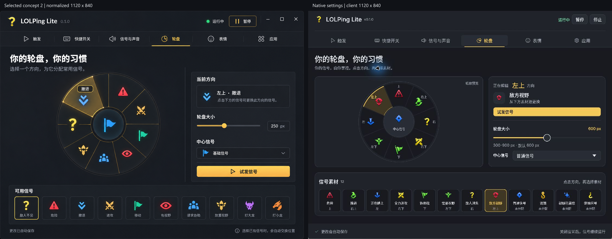

# LOLPing Lite 原生设置改版：视觉验收

验收日期：2026-10-17（Asia/Shanghai）。方法：Product Design `design-qa`，按源图与实际原生窗口进行归一化并排和局部检查。

**Findings**

当前截图中没有待修复的 P0、P1 或 P2 视觉问题。上一轮“轮盘素材池落在首屏之外”的 P2 已修改并复拍验证。这里只判定已捕获的 Windows 原生界面；不把截图、静态代码检查或编译通过当作完整功能、性能或三端实机验收。

**版本边界：**下方设计比较图片来自本轮已验证的 `0.1.0 ui-preview` 原生设置构建，所以顶栏仍显示 `v0.1.0`。交付源码已将元数据升为 `0.2.0`；本报告对应的视觉代码没有随后改动。三轮性能测量结束后，另用实际 `0.2.0` 本机构建补拍了 [最终轮盘页](docs/images/ui-0.2.0-release-wheel.jpg)，确认版本号、字体、固定栏及完整素材池正常。文件名中的 `ui-0.2.0-` 表示此次 UI 改版；只有这张补拍来自 0.2.0 二进制，其他比较图仍保留原始预览证据。

## 比较目标、视口与证据

- Source visual truth：用户选定的第二张设计，[归档原图](docs/images/ui-0.2.0-reference.png)，1448 × 1086 px。归档保留生成原图的原始字节，发布文档不包含本机用户目录。
- Implementation screenshot：实际 Rust / egui / Glow 原生窗口，[最终深色轮盘](docs/images/ui-0.2.0-wheel-dark.jpg)，原路径 `.cache/design/after/04-wheel-dark.jpg`，1123 × 871 截图像素。不是浏览器页面或设计图贴图。
- State：中文、深色、运行中、轮盘 TAB、左上方向被选中。源图左上为“撤退”，实际为真实配置中的“敌方视野”；两者都展示选中状态，但素材内容不是相同数据集。实际图上的光标及蓝色光晕属于捕获指针标记，不是界面装饰。
- Native viewport：默认客户端 1120 × 840；最小测试客户端 760 × 560。没有 CSS viewport 或浏览器 `deviceScaleFactor`，这些字段不适用于本应用。
- Density normalization：Windows 系统显示缩放始终为 **150%**，没有修改操作系统 DPI。Sky 返回 API 截图像素，不能把尺寸直接当作物理显示器像素。去掉原生标题栏及边框：左 1、上 30、右 2、下 1 像素。默认截图得到 1120 × 840 内容区；源图保持宽高比缩放至同样尺寸（约 77.35%），不拉伸任何素材。
- 原图将窗口控制融合在自绘顶栏；实现保留系统标题栏。比较用内容区移除了额外原生窗框，但没有擦除设计源图中的窗控。这一平台差异不作为字体或内容间距缺陷。

| 证据 | 原始截图 | 客户端捕获区 | 应用 zoom | 等效 egui 布局区域 |
| --- | --- | --- | --- | --- |
| [默认深色轮盘](docs/images/ui-0.2.0-wheel-dark.jpg) | 1123 × 871 | 1120 × 840 | 100% | 1120 × 840 |
| [窄窗触发](docs/images/ui-0.2.0-narrow-trigger.jpg) | 763 × 591 | 760 × 560 | 100% | 760 × 560 |
| [窄窗轮盘滚动](docs/images/ui-0.2.0-narrow-wheel-scroll.jpg) | 763 × 591 | 760 × 560 | 100% | 760 × 560 |
| [150% 应用缩放](docs/images/ui-0.2.0-scale-150.jpg) | 1443 × 1031 | 1440 × 1000 | 150% | 960 × 约 667 |
| [200% 中文](docs/images/ui-0.2.0-scale-200-zh.jpg) | 1603 × 1151 | 1600 × 1120 | 200% | 800 × 560 |
| [200% 英文](docs/images/ui-0.2.0-scale-200-en.jpg) | 1603 × 1151 | 1600 × 1120 | 200% | 800 × 560 |

应用 zoom 是文字与布局缩放的代理覆盖，**不是已经验证 100%／150%／200% 系统 DPI 切换**。真实混合 DPI、多显示器迁移仍是未覆盖项。

### 全图与关键区域比较

以下是实际合成为同一输入并已打开检查的并排证据，不是把两张独立图片分别看过就当作并排比较。

- [全图比较](docs/images/ui-0.2.0-reference-comparison.png)：每侧 1120 × 840，检查信息架构、主区域比例、素材池与固定导航。
- [顶栏、TAB 与标题](docs/images/ui-0.2.0-header-comparison.png)：分别截取归一化图片中的 1080 × 225 区域，检查品牌、字重、文字层级、图标和激活线。
- [参数卡局部](docs/images/ui-0.2.0-controls-comparison.png)：源图区 400 × 405、实现区 430 × 335，分别等比放入 520 × 520 比较格；用来检查表单、按钮、滑块与文字，不用这种二次缩放推断整体尺寸。
- [素材池局部](docs/images/ui-0.2.0-assets-comparison.png)：源图区 1060 × 148、实现区 1070 × 163，等比展示，检查选中边框、透明素材、名称与分配状态。
- [200% 中英文归一化](docs/images/ui-0.2.0-scale-comparison.png)：两个 1600 × 1120 客户端各缩至 800 × 560，检查长英文 TAB、设置行和固定底栏，没有横向溢出或持久控件消失。

## 五项保真检查

| 检查面 | 结果及证据 |
| --- | --- |
| 字体与排版 | 已检查中英文字形、fallback、实际 Regular／Medium 字重、标题与辅助说明层级、换行及截断。Inter 与 Noto CJK 子集取代不一致的默认字体；标题按批准方案使用 28 逻辑像素，常用正文 16、辅助说明 14。源图无法提供可验证字体文件，且图中标题比批准的 28px 规格更粗；实现遵循批准的可读字号与真实 Medium 字重，作为预期差异。200% 中英文放大后字形完整，没有方块字、重叠或异常字距。JPG 截图会产生轻微压缩边缘，不以截图压缩代替对字体资源质量的判断。 |
| 间距与布局节奏 | 目标的固定顶栏、六类横向 TAB、左轮盘／右参数／下素材池关系已实现。窄窗口纵向排列，内容滚动而导航和保存栏固定。卡片边框、内容边距与节间距统一；最终默认轮盘首屏同时看见参数与完整 12 种素材。实际圆盘比概念图略小，参数区更紧凑，是保持真实 12 项素材与默认 1120 × 840 可操作首屏的适配；不再有前轮素材池被挤出首屏的问题。 |
| 色彩与视觉 token | 保留深石墨、金色选中态、浅色正文和细分隔线；未将整套系统控件保留为默认灰色样式。使用平面色面代替概念图的大面积背景渐变与发光，符合本轮原生轻量绘制约束。正文／辅助／强调／成功／错误色在三种内容底色上的静态最低对比度：深色 5.73:1、浅色 4.83:1。该数字来自实际 token 计算，不是对所有控件或 JPEG 像素作出的全局无障碍保证。运行状态同时有文字，选中态同时有下划线与背景。 |
| 素材与图标质量 | 真实黄色问号品牌图、原版信号与表情素材均保留透明背景；未用 emoji、手绘 SVG 或占位图替换。导航使用官方 Fluent System Icons，静态 PNG 的源路径与 MIT 声明齐全。源图含“打大龙／打小龙”等生成示例及重绘信号，而批准方案明确只保留现有 12 种信号；因此改用真实素材属于必要内容校正。轮盘扇区是可交互控件，按批准方案用 egui 绘制，不是对图片资产的伪造。素材没有被拉伸，200% 导航未显著模糊或出现透明灰框。 |
| 文案与内容 | 六个 TAB 为触发、快捷开关、信号与声音、轮盘、表情、应用；新增页面文案面向独立应用。源图的 250px 示例改为真实 300–900px 范围、默认 600px，并标明“缩放预览”。试发与分配分开；素材池展示真实名称和槽位状态。扩展包卡片提供 GitHub 下载入口与资源文件说明。应用页保留来源与 Riot 归属。没有把开发任务说明、设计稿序号或未实现占位功能写入产品主操作。 |

### 其余页面及状态

已查看 [触发](docs/images/ui-0.2.0-trigger-dark.jpg)、[快捷开关](docs/images/ui-0.2.0-hotkey-dark.jpg)、[信号与声音](docs/images/ui-0.2.0-sound-dark.jpg)、[表情库](docs/images/ui-0.2.0-emotes-dark.jpg)、[导入后筛选](docs/images/ui-0.2.0-import-search.jpg)、[应用](docs/images/ui-0.2.0-app-dark.jpg) 和 [浅色英文应用页](docs/images/ui-0.2.0-app-light-en.jpg)。源图只覆盖深色轮盘，其他页面作为同一设计语言的批准延展检查，不声称存在对应的像素级源稿。

- 深浅色都保持相同卡片布局与语义层次；浅色强调色改为可读的深金色。
- 默认、窄窗及 150%／200% 应用 zoom 下，顶栏动作、六个 TAB 和保存底栏没有被内容推出视口。
- [窄窗轮盘滚动截图](docs/images/ui-0.2.0-narrow-wheel-scroll.jpg)展示了滚动中的圆盘裁剪；这是内容滚动状态，顶栏和底栏仍完整，不是轮盘绘制残缺问题。
- 读屏标签与键盘语义另经源码检查：图片按钮、滑块、下拉框、搜索框有可访问名称，轮盘方向与素材支持键盘操作；截图只证明可见焦点／选中样式，不能证明屏幕阅读器实测通过。
- 原生应用不适用浏览器 console error 检查。本报告没有进行新的 UI 操控；操作、配置保存、录制恢复、导入与进程生命周期的实际测试由主流程独立记录。

## P0／P1／P2 比较历史

### 第一轮：blocked — [P2] 素材池不在默认轮盘首屏

- Location：轮盘 TAB 主体，默认客户端 1120 × 840。
- Evidence：源图明确同时展示轮盘、参数与下方素材池；[早期实际截图](docs/images/ui-0.2.0-wheel-before.jpg)中左右卡片过高，素材池完全在保存底栏以下。用户看不到“选择方向之后选择素材”的下一步。
- Impact：改变了首屏信息密度与主要编辑流程，不能仅归为审美偏好。
- Fix：紧凑桌面模式减少重复说明与竖向间距、缩短预览画布、将方向信息合并为单行、压缩参数排列；保留窄屏纵向滚动模式。
- Post-fix evidence：[前后同尺寸并排](docs/images/ui-0.2.0-iteration-comparison.png)和[最终截图](docs/images/ui-0.2.0-wheel-dark.jpg)显示：两个主卡片高度接近，全部 12 种素材在默认首屏完整呈现，保存状态仍固定可见。复查结论：已解决。

其他此前静态审阅提出的英文 TAB 宽度、设置行额外间距、图标按钮命名和开关点击区问题已在代码中调整。它们没有保存“修复前截图”，因此不伪装成独立的视觉 QA 迭代；最终窄窗和 200% 英文证据用于确认没有残留溢出。

### 第二轮：passed

以最终真实截图重新执行全图、导航／字体、参数控件、素材和高 zoom 中英文比较，没有发现仍然可执行的 P0／P1／P2 修复项。

## Open Questions

没有阻塞本轮 Windows 视觉交付的开放问题。仍需单独验证：macOS／Linux 实机字体与窗口行为、真实系统 DPI 迁移、读屏实际播报，以及加载失败／IPC 长时间无响应／权限拒绝等未提供截图的异常状态。不能据本报告宣称这些全部通过。

## Implementation Checklist

- [x] 源图和实际实现可打开，已放入同一个并排比较输入。
- [x] 记录原始尺寸、客户端裁剪、密度与应用 zoom，排除窗框和指针标记误判。
- [x] 覆盖字体、布局、色彩、图像与产品文案五项保真检查。
- [x] 前轮 P2 有修复前证据、具体调整和同尺寸复拍对照。
- [x] 检查六类页面、深浅色、中英文及窄窗／高 zoom 状态。
- [x] 真实截图与比较图已归档为仓库内可移植相对链接。
- [ ] 新版本发布二进制、功能／性能／生命周期与三端实机结论由专项验收给出。

## Follow-up Polish

- [P3] 如后续追求更接近概念稿，可给轮盘参数卡中的“试发”按钮补上现有 Fluent play 图标、居中文字；当前按钮的金色对比与文字已清楚，不影响使用。
- [P3] 外圈信号图在紧凑桌面布局中比概念图小，后续可在更大窗口逐步增大圆盘，而不牺牲默认视口中的完整素材池。当前尺寸是本轮可接受的轻量布局取舍。

final result: passed
